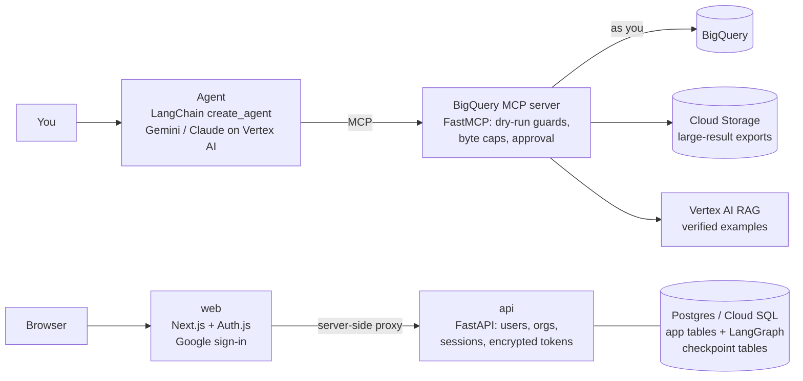

# BigQuery Text-to-SQL Analyst

Ask questions about your BigQuery data in plain English and get answers backed by real query results.

An LLM agent writes BigQuery SQL, checks it with a dry run, shows you the query and its estimated cost, and runs
it only after you approve. It answers with the numbers, a table, and the SQL it ran. Queries run **with your own
Google account**, so BigQuery IAM decides what you can see: the server never holds a service account with access to
your data.

It comes with what it takes to run for real users: Google sign-in, encrypted credential storage, a Postgres data
model, one-command local stack, Cloud Run + Cloud SQL deployment with per-service CI/CD, and a benchmark that
compares models on 50 questions.

---

## What it does

- **Read-only by construction.** Every query is dry-run first. Only `SELECT` statements pass (BigQuery reports the
  statement type, so there's no SQL parsing to fool). Every referenced table must be in an allowed dataset, and a
  byte cap is enforced twice: by the server and by BigQuery's `maximum_bytes_billed`.
- **Human in the loop.** You see the SQL, the tables it touches and the estimated GB and cost before anything runs.
- **Learns from verified examples.** Answers you confirm become question → SQL examples in a Vertex AI RAG corpus.
  The agent retrieves the closest ones before writing new SQL, and follows the business rules stored with them.
- **Large results don't flood the chat.** Up to 500 rows come back inline. Bigger results are exported to Cloud
  Storage and returned as a download link (time-limited signed URL when a signer account is set), plus a preview.
- **Any Vertex AI model.** Gemini, or Claude on Vertex AI, picked by model id.
- **Measured, not guessed.** A 50-question eval suite (DeepEval) scores execution accuracy, workflow, answer
  correctness, faithfulness and behaviour on ambiguous / unanswerable / off-topic questions.

## Architecture



| Component | Stack | Role |
|---|---|---|
| `mcp_server/` | FastMCP 4, google-cloud-bigquery, Vertex AI RAG | The only component that talks to BigQuery: `list_tables`, `describe_table`, `sample_rows`, `column_values`, `validate_sql`, `run_sql`, `search_examples`, `save_example`. Detailed per-call logs (call id, user, GB, cost, latency) |
| Agent | LangChain `create_agent`, `langchain.mcp.MCPAdapter`, Gemini / Claude on Vertex AI | A 7-step loop: understand → retrieve examples → ground in the schema → write and validate → run (approved) → answer → ask for feedback |
| `web/` | Next.js 16 (App Router), TypeScript, Tailwind, Auth.js v5 | Google sign-in with the BigQuery scope; a backend-for-frontend proxy, so no token ever reaches browser JavaScript |
| `api/` | FastAPI, SQLAlchemy 2 (async), Alembic | Verifies Google ID tokens, stores refresh tokens encrypted, issues revocable sessions, mints per-user access tokens; data model for orgs, datasets, examples, chats |
| `evals/` | DeepEval | 50-question benchmark: execution accuracy, workflow, LLM-judged correctness, faithfulness, behaviour |
| Postgres | Postgres 17 + pgvector (Cloud SQL in prod) | Schema `app` (Alembic) and schema `checkpoints` (LangGraph `AsyncPostgresSaver`) |

Each service is its own Docker image and its own Cloud Run service, built and deployed by its own GitHub Actions workflow.

## Try the agent

```powershell
uv sync --all-packages
uv run mcp_server/bq_mcp_server.py          # settings in mcp_server/.env (keys listed at the top of bq_mcp_server.py)
```

Then open [agent_test.ipynb](agent_test.ipynb). It signs you in with Google, connects the agent to the MCP server,
and lets you ask questions such as *"Top 5 pickup zones by revenue in March 2025"*. Each query pops up for approval
with its SQL and estimated cost before it runs.

## Run the platform locally

Prerequisites: Docker, [uv](https://docs.astral.sh/uv/), Node 24, the gcloud CLI, and a Google Cloud project with BigQuery.

```powershell
gcloud auth application-default login            # server-side Google credentials (mounted read-only)
Copy-Item infra\.env.example infra\.env           # fill in project, buckets, OAuth client
.\scripts\dev.ps1 up                               # Linux/macOS: make up
```

| URL | |
|---|---|
| http://localhost:3000 | web app |
| http://localhost:8080/docs | API (OpenAPI) |

`docker compose` starts Postgres, runs the migrations once (app tables + LangGraph checkpoint tables), then starts
mcp, api and web, in that order, gated by health checks. Details: [docs/local-dev.md](docs/local-dev.md).

Demo data: [data_loader.ipynb](data_loader.ipynb) loads 2025 NYC yellow-taxi trips (about 45M rows) into BigQuery as
bronze → silver tables with column descriptions and date partitioning.

### Python

One uv workspace, one lock file:

```powershell
uv sync --all-packages             # api + mcp_server + evals + notebook deps into .venv
uv run pytest -q                   # api tests use a throwaway Postgres database
uv add --package analyst-api <pkg> # add a dependency to one service
```

## Deploy (Google Cloud)

Prod runs on **Cloud Run** in `asia-south1`, next to the BigQuery data, with **Cloud SQL for PostgreSQL**.

```bash
bash infra/gcp/bootstrap.sh        # APIs, Artifact Registry, service accounts + IAM, secrets, GitHub WIF
bash infra/gcp/setup_cloudsql.sh   # Postgres 17 instance, database, user (password in Secret Manager)
```

Then push to `main`. GitHub Actions authenticates with **Workload Identity Federation** (no service-account keys),
and runs a separate pipeline per service:

```
deploy-mcp: test → build → push → deploy → only sa-api may invoke
deploy-api: test → build → push → migrate job (Cloud SQL) → deploy → smoke test
deploy-web: lint → build → push → deploy → smoke test
```

Runbooks: [docs/deploy.md](docs/deploy.md), [docs/cloudsql.md](docs/cloudsql.md) (including a manual SQL script for the tables).

## Security model

| Concern | How it's handled |
|---|---|
| Who can see which data | Queries run with the **signed-in user's Google token**; BigQuery IAM applies |
| Writes / DDL / scripts | Rejected: dry-run `statement_type` must be `SELECT` |
| Runaway cost | Per-query byte cap (server check + `maximum_bytes_billed`); estimate shown before approval |
| Tokens in the browser | None: web proxies API calls server-side; the API token lives in an encrypted httpOnly cookie |
| Stored Google refresh tokens | Fernet-encrypted at rest, with key rotation; never returned by the API |
| Org membership | From Google's verified Workspace domain (`hd` claim), not the email suffix |
| Service-to-service | mcp accepts only `sa-api` (Cloud Run IAM); least-privilege service account per service |
| Secrets | Secret Manager in prod; nothing in the repo or in GitHub |

Details: [docs/auth.md](docs/auth.md).

## Evals

50 questions over the NYC taxi data in 7 categories: easy, medium, hard (windows, CTEs, ranking), relative dates
("last month"), ambiguous (should ask a clarifying question), unanswerable, and off-topic. Expected results come from
golden SQL. None of the questions are among the RAG seed examples.

Sample run: 14 questions (2 per category), RAG on, judged by `gemini-3.8-flash`.

| Model | Execution accuracy | Answer correctness | Faithfulness | Behaviour | Workflow | Avg latency | Avg GB / question |
|---|---|---|---|---|---|---|---|
| gemini-3.1-pro-preview | **0.88** | 0.96 | 1.00 | **1.00** | **1.00** | **23.6 s** | **0.22** |
| gemini-3.6-flash | 0.63 | 0.88 | 0.90 | 0.83 | 0.93 | 60.3 s | 0.39 |
| gemini-3.8-flash | 0.50 | 0.88 | 1.00 | 0.83 | 0.93 | 46.7 s | 0.55 |
| gemini-3.5-flash | 0.50 | **0.99** | 1.00 | 0.83 | 0.90 | 32.8 s | 1.47 |

*Execution accuracy* compares the agent's result table with the golden result, so it's strict about grain and
columns. *Answer correctness* is an LLM judge reading the final answer. The sample is small (2 per category), so
treat the gaps as indicative. Run it yourself:

```powershell
uv run evals/run_all.py --models gemini-3.8-flash gemini-3.1-pro-preview
```

More: [evals/README.md](evals/README.md).

## What's next

- Bring the agent into the web app: streaming answers, an approve / edit / reject card for each query, and chat
  history persisted with the LangGraph checkpointer (the tables already exist).
- Let each user register their own datasets, with private or org-shared verified examples.
- Per-user memory (Mem0) for preferences and term definitions, never data.

## Repository layout

```
agent_test.ipynb   try the agent end to end
data_loader.ipynb  load the NYC taxi demo data into BigQuery
web/            Next.js app (sign-in, BFF proxy, UI)
api/            FastAPI app, models, Alembic migrations, tests
mcp_server/     FastMCP BigQuery server, RAG store, 26 seed examples
evals/          DeepEval suite, golden results, leaderboard
infra/          docker-compose, .env template, Cloud Run env files, GCP scripts, Cloud SQL DDL
docs/           local dev, auth, deploy, Cloud SQL
scripts/        dev helper (PowerShell), SQL generator
.github/        CI and per-service deploy workflows
```
